<div align="center">

# VibeApp AI

**Describe an app or a game. Watch it appear on an iPhone or Android simulator. Ship it anywhere.**

A native macOS studio for building iPhone, iPad, Android, web, desktop and **3D** apps and games with any AI model, and for **remaking existing apps** for other devices.


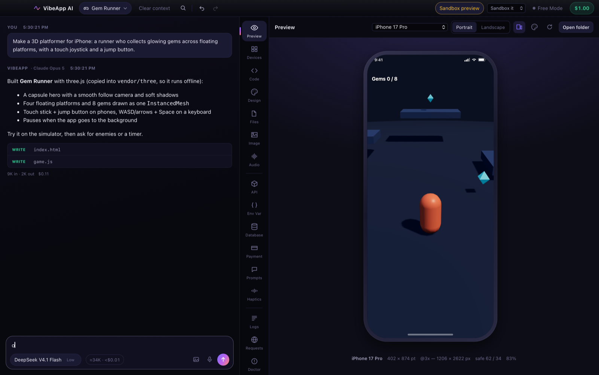

<sub>A three.js platformer from the built-in 3D starter, running live in the iPhone simulator.</sub>

</div>

---

## What it does

| | |
|---|---|
| **Build by describing** | Chat with any of 400+ models: OpenRouter, Anthropic, OpenAI, Google, Z.ai, DeepSeek, Groq, any OpenAI-compatible provider (Venice and Featherless for uncensored and fine-tuned models), or local Ollama, LM Studio, llama.cpp, KoboldCpp and Jan. |
| **iPhone and Android simulators** | Every change shows up live on 17 iPhones, 3 iPads and Android phones and tablets: Material status bar, gesture or 3-button navigation with a working Back, an Android user agent. One click opens the app in the real Android Emulator. |
| **Setup, out of the box** | On first launch, pick the engines, languages and local-model runners you want: one-click installs or official links, or Skip. Built-in tools and hosted tool servers work with nothing installed. |
| **Asset Vault and Feature Kits** | Save 3D models, textures, skies, sounds and fonts once and drop them into any project. Save part of an app — whole files or portions — and add it to another app; the AI wires it in. |
| **WebAssembly** | Rust and Zig → WebAssembly projects, plus C/C++ (Emscripten), Go (TinyGo) and AssemblyScript in the stack. Pin hard rules (“all logic in Zig”); the AI is told which language reaches which device. |
| **3D games and engines** | three.js games that run right in the preview, plus **Godot**, **Unity** and **Unreal Engine** projects you can open, run, check and build with your own engine, and ray-traced **vork** scenes rendered on your GPU. |
| **Remake anything** | Point it at a website, a source folder, a Mac `.app` (Electron apps included), an iOS `.ipa` or an Android `.apk`. It reads the app without running it and writes a port brief. Then it rebuilds the app for phone, tablet, desktop or web. |
| **Tools over MCP** | Models can call tools on MCP servers you connect: Ghidra (via REA, ReVa or GhidraMCP), Godot, Unity, Unreal, Blender, Meshy, Playwright, GitHub and more. You approve each call. |
| **Plug-ins** | Bundles of skills, MCP servers, slash commands, themes and instructions that switch on and off together. Claude Code plug-ins install as they are. |
| **Skills** | Instruction packs that load only when they fit the request. Built-in packs cover iPhone layout, game feel, accessibility, 3D, every engine, animation, reverse engineering and porting. |
| **Safe edits** | Apply changes live, review them first, or try them in a sandboxed copy. Undo, redo and rewind work on every turn, and a crash journal means a long reply is never lost. |
| **Audit** | Checks accessibility, credentials, offline use, performance, localisation, ship-readiness, and phone and tablet readiness, with a one-click fix for each finding. |
| **Swarms and Arena** | Several models work blind to each other's identity, with gates between stages. Or send one prompt to several models and keep the best result. |
| **Export** | Xcode project, PWA, Electron, Android, and iOS Simulator runs. Engine projects build WebGL, iOS and Android through the engine. |

## Gallery

<table>
<tr>
<td width="50%">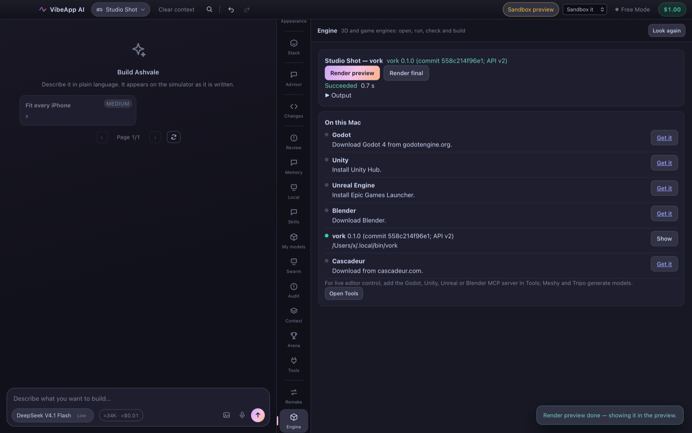<br><b>Engine</b>: open, run, check and build with Godot, Unity, Unreal or vork. Errors go straight back to the model.</td>
<td width="50%">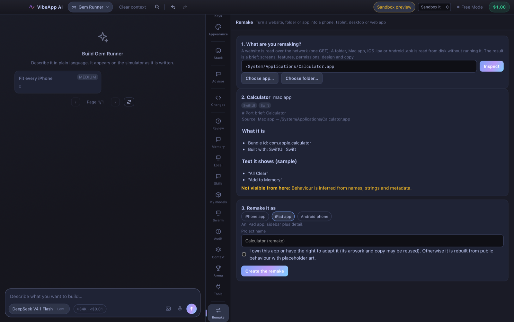<br><b>Remake</b>: inspect an app, read its brief, pick iPhone, iPad, Android, web or desktop.</td>
</tr>
<tr>
<td>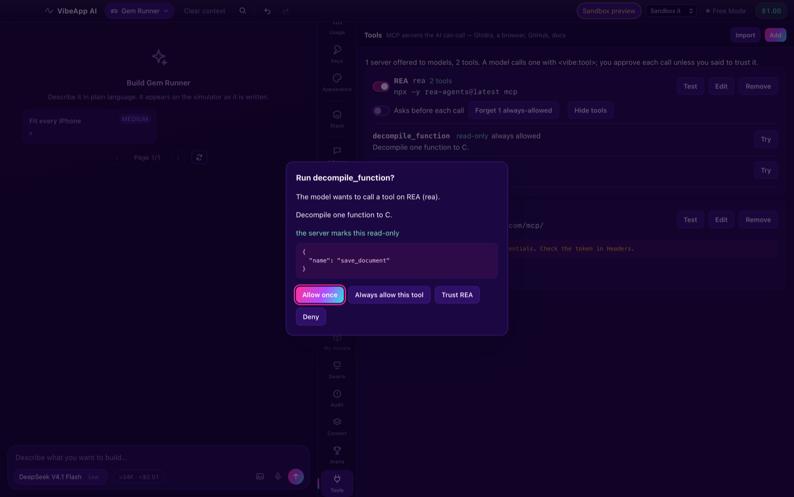<br><b>Tools</b>: every MCP call waits for your approval unless you've trusted that tool or server.</td>
<td>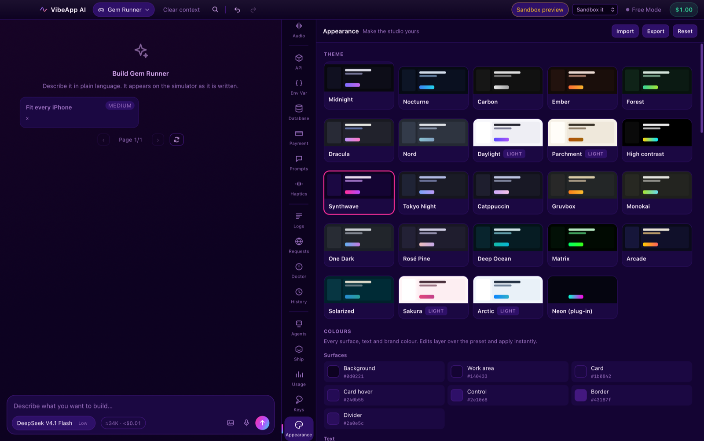<br><b>Themes</b>: 23 built-in themes, plus any a plug-in adds. Every colour is editable.</td>
</tr>
<tr>
<td>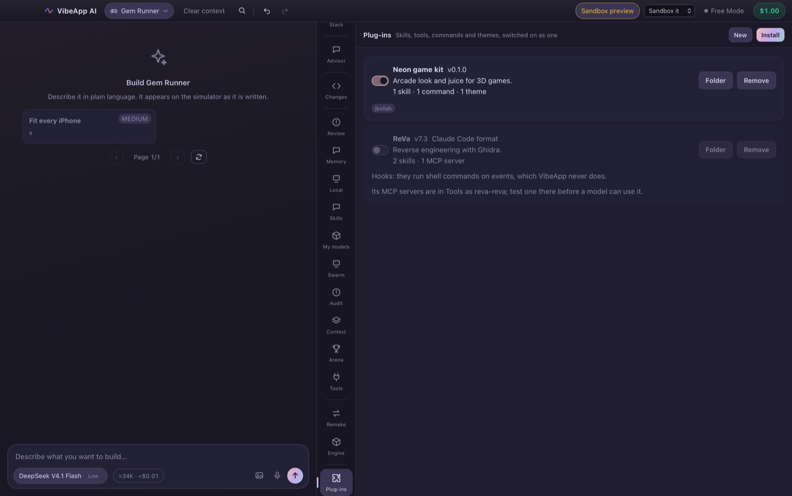<br><b>Plug-ins</b>: make your own from a template, or install from GitHub or a folder.</td>
<td>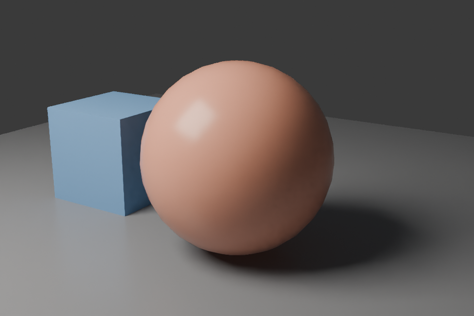<br><b>vork</b>: the starter scene, ray-traced on this Mac in 10 seconds.</td>
</tr>
</table>

## The 3D starter

<table>
<tr>
<td width="50%">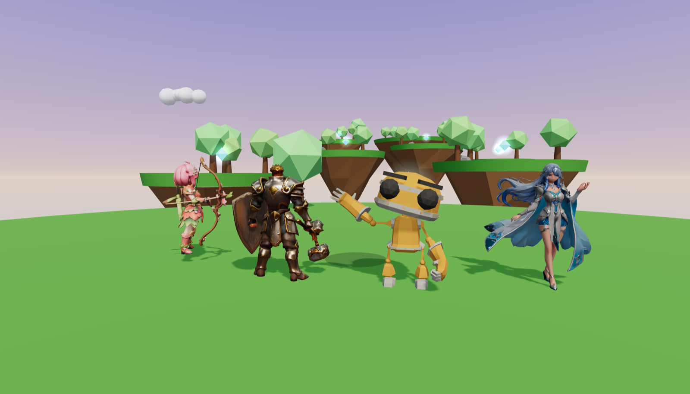<br><b>Pick a hero.</b> The start screen lines up every character in <code>assets/characters</code>. Drop in any <code>.glb</code>; rigged ones animate, static ones run procedurally.</td>
<td width="50%">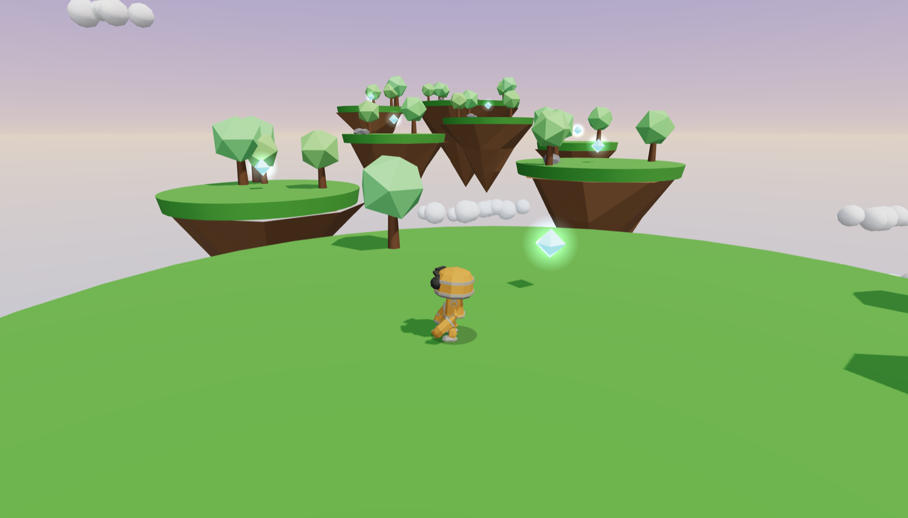<br><b>Play.</b> Floating islands, soft shadows, glowing gems, double jump, coyote time, touch stick and keyboard. three.js r186 is copied in, so it runs offline.</td>
</tr>
<tr>
<td>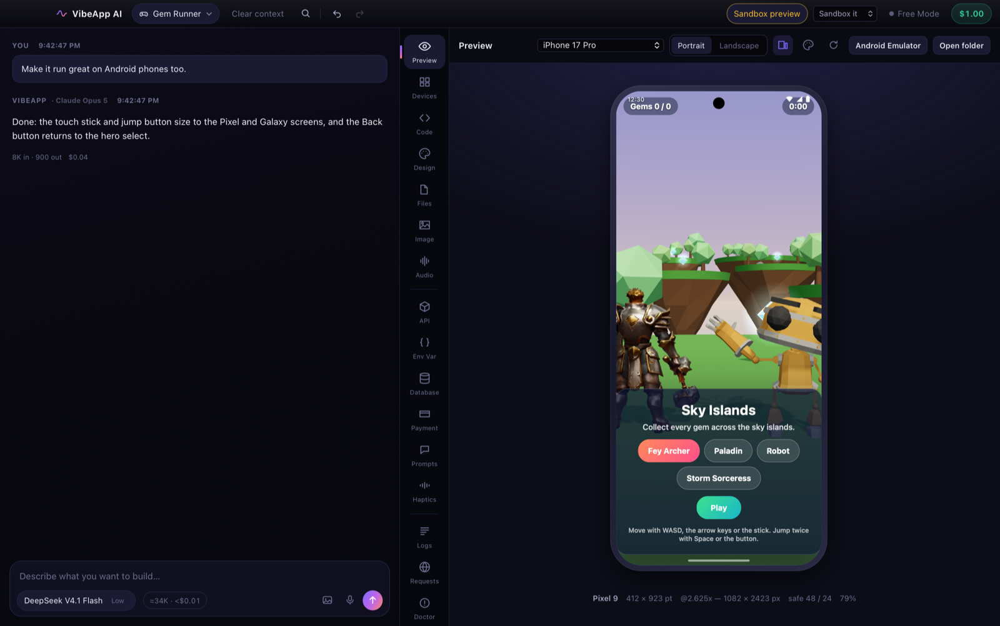<br><b>On Android.</b> Pixel and Galaxy devices with Android chrome; the real Android Emulator is one click away.</td>
<td>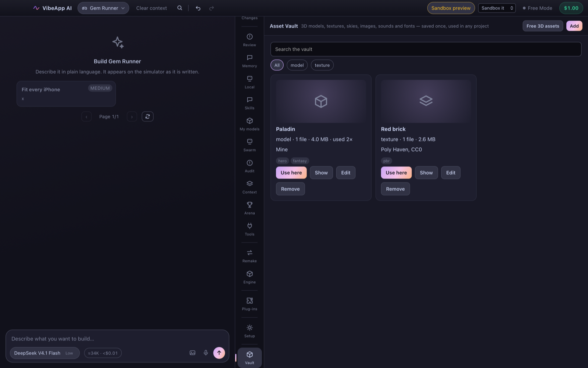<br><b>Asset Vault.</b> Keep models and textures; <b>Free 3D assets</b> links the best free libraries.</td>
</tr>
</table>

### Free 3D assets

| Library | What you get | Licence |
|---|---|---|
| [Poly Haven](https://polyhaven.com/models) | Models, PBR textures, HDRI skies — models can also fetch these for you | CC0 |
| [Kenney](https://kenney.nl/assets/category:3D) | Thousands of game-ready low-poly kits | CC0 |
| [Quaternius](https://quaternius.com) | Rigged, animated characters and themed packs | CC0 |
| [KayKit](https://kaylousberg.itch.io) | Stylised characters, dungeons and cities with animations | CC0 |
| [Poly Pizza](https://poly.pizza) | Searchable low-poly models | CC0 / CC-BY |
| [ambientCG](https://ambientcg.com) | PBR materials, HDRIs, models | CC0 |
| [Sketchfab](https://sketchfab.com/search?features=downloadable&type=models) | Huge library; filter by downloadable and licence | per model |
| [Mixamo](https://www.mixamo.com) | Rigged characters and hundreds of animations | free (Adobe account) |
| [Khronos glTF samples](https://github.com/KhronosGroup/glTF-Sample-Assets) | Reference glTF models | per model |
| [itch.io free 3D](https://itch.io/game-assets/free/tag-3d) · [OpenGameArt](https://opengameart.org) · [Fab](https://www.fab.com) · [BlenderKit](https://www.blenderkit.com) | Indie packs, community art, Epic's marketplace, Blender library | per item |
| [Smithsonian 3D](https://3d.si.edu) · [NASA 3D](https://science.nasa.gov/3d-resources/) | Museum scans, spacecraft and planets | mostly free / CC0 |

## 3D, the whole pipeline

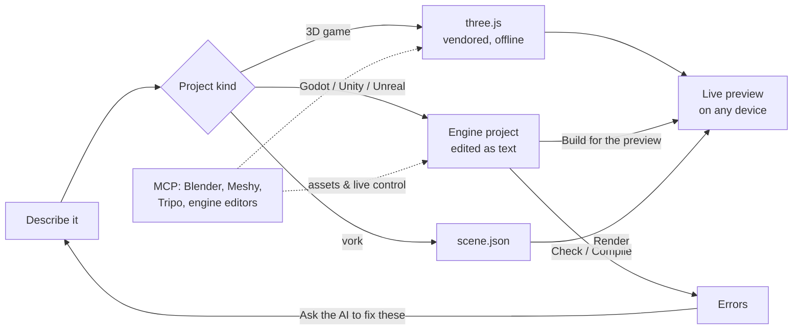

- **three.js**: r186 is copied into each project, so games run offline, and the starter is a playable platformer that works with touch and keyboard. The model is told the budgets that keep a game smooth on a phone.
- **Godot 4**: text scenes and GDScript, a gl_compatibility renderer, and a Web export preset that runs without special server headers. **Check** loads the project headless and reports script errors. **Build for the preview** exports to the web and plays the result in VibeApp.
- **Unity**: C# with a scene built in code, so there's no hand-made YAML to break. An editor build script makes WebGL, iOS and Android builds; WebGL plays in the preview.
- **Unreal Engine 5**: a C++ module, a GameMode, Enhanced Input and the config files. **Compile** reports errors with file and line. Blueprints stay in the editor.
- **vork**: ray-traced stills and shots. VibeApp gives the model the scene reference from your installed vork, renders, and shows the image.
- **Animation**: the character animation skill covers rigs, clip blending and retargeting, plus round-tripping through [Cascadeur](https://cascadeur.com) as FBX or glTF.
- **Assets**: glTF budgets and licensing rules, plus Meshy, Tripo and Blender over MCP for generating and cleaning up models.

Importing an existing Godot, Unity, Unreal or vork folder recognises the engine and leaves its caches behind. Unity's `Library/` is often gigabytes, and none of it is source.

## Trust model

- API keys and MCP secrets are kept only in the macOS Keychain. They are never written to disk or a log, and the public repo contains no keys: `tools/check.py` fails on any key-shaped string.
- Model output is untrusted.
  - A model never runs a shell command: `<vibe:shell>` is shown to you, never executed.
  - It never writes outside the project.
  - It only picks a tool and its arguments on an MCP server you defined, never a command line.
- Engine actions start only from a button you press. The first time one runs a project's own code natively, VibeApp says so and asks first.
- Remake inspection is static: nothing is executed and nothing is uploaded.
- Plug-ins install text files only. Claude Code hooks and scripts are never run.

## Windows

A Windows build is set up but not yet tested on a Windows machine. The [Windows build workflow](.github/workflows/windows.yml) compiles the installer (NSIS `.exe`) on GitHub's Windows runners: run it from the Actions tab. The core, the preview, models, MCP tools and the engines work there; the macOS-only parts (Xcode export, iOS Simulator, Mac app inspection, Spotlight detection) say so instead of running.

## Build

Requirements: macOS on Apple silicon, Rust (stable), Node 18+, and the Xcode command-line tools.

```bash
npm install
python3 tools/check.py              # frontend checks, Rust tests and invariants
npx tauri build --bundles app       # builds src-tauri/target/release/bundle/macos/VibeApp AI.app
./tools/package_dmg.sh              # signs (ad hoc) and writes a DMG to ~/Downloads
```

Read [ARCHITECTURE.md](ARCHITECTURE.md) before changing anything. It explains the output protocol and the orchestration loop, lists every bug already fixed (each guarded by a test), and gives the invariants that must hold. [AGENT_PROMPT.md](AGENT_PROMPT.md) is the brief for an AI agent continuing the work.

## Credits

- [three.js](https://threejs.org) r186: MIT, copied into 3D projects with its licence.
- The starter's robot: [RobotExpressive](https://github.com/mrdoob/three.js/tree/dev/examples/models/gltf/RobotExpressive) by Tomás Laulhé (Quaternius), CC0. The Fey Archer, Paladin and Storm Sorceress in the screenshots are the author's own models and are not included.
- [vork](https://github.com/voyager-so/vork) by Voyager: used through your own install, never bundled. It's source-available under its preview licence.
- MCP servers are their authors' projects and are installed by you. The Tools panel links each one.

## License

[MIT](LICENSE) © 2026 Chris Carty
